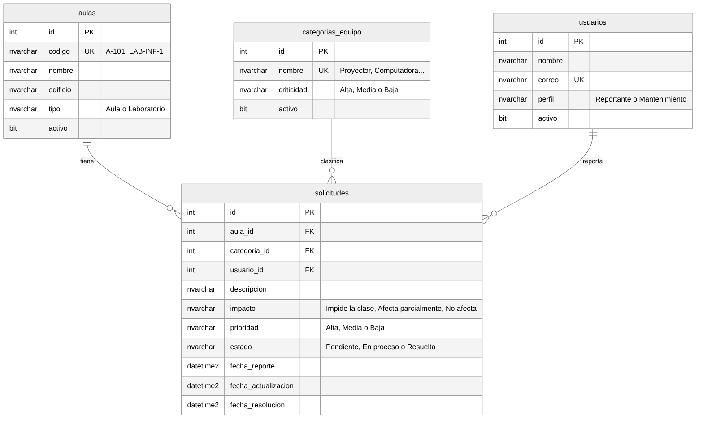
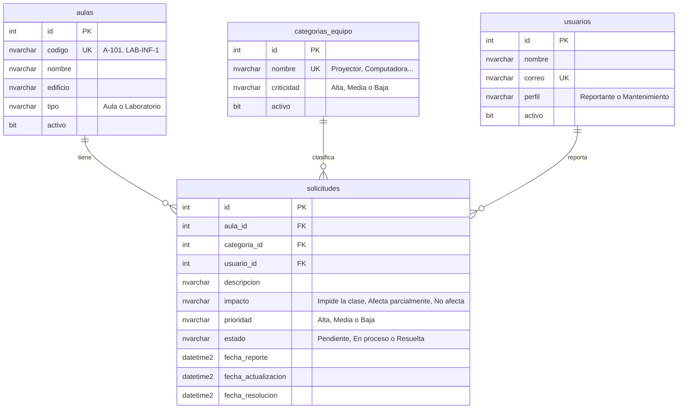

# Modelo de datos

Tarea 1.1 · Script: [`db/01_esquema.sql`](../db/01_esquema.sql)

## Tablas

| Tabla | Para qué sirve |
|---|---|
| `aulas` | Aulas y laboratorios donde se reportan averías. |
| `categorias_equipo` | Tipos de equipo (proyector, computadora, aire acondicionado...). Su **criticidad** se usa para calcular la prioridad. |
| `usuarios` | Personas que usan el sistema, con su perfil: **Reportante** o **Mantenimiento**. |
| `solicitudes` | Cada avería reportada, con su impacto en la clase, prioridad y estado. |

## Reglas que garantiza la base de datos

- **Llaves foráneas:** una solicitud siempre apunta a un aula, una categoría y un usuario que existen.
- **Valores permitidos (CHECK):** tipo de aula, criticidad, perfil, impacto, prioridad y estado solo aceptan los valores de la lista.
- **Una sola solicitud activa por aula y categoría:** el índice único filtrado `ux_solicitudes_una_activa`
  impide dos solicitudes *Pendiente* o *En proceso* para la misma aula y categoría (regla RD-01).
  Las solicitudes *Resueltas* no cuentan, así que la avería se puede volver a reportar.
